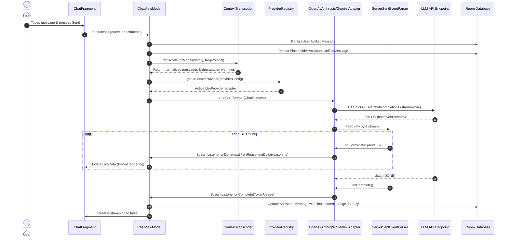

# OmniChat Architecture Documentation

## 1. Executive Architectural Overview

OmniChat is an enterprise-grade, multi-provider Android AI client built strictly in **Java 17** utilizing **Android Architecture Components**, **AndroidX Room (SQLite)**, **Material Design 3**, and **Clean Architecture (MVVM)**.

### Architectural Core Tenets
1. **Zero-Kotlin, Zero-Compose Constraint**: The entire codebase is implemented in pure modern Java 17 with standard Android XML Views and ViewBinding.
2. **Provider-Agnostic Core**: The core domain model (`UnifiedMessage`, `Conversation`, `ModelDescriptor`, `CapabilitySet`) is completely decoupled from provider-specific JSON schemas (OpenAI, Anthropic, Google Gemini, Azure OpenAI, AWS Bedrock, Ollama, Local AI).
3. **Mid-Conversation Dynamic Model Switching**: Users can switch models seamlessly mid-thread. The `ContextTranscoder` intercepts the message history, analyzes token budget constraints, transcribes unsupported modalities (e.g. converting image inputs into descriptive transcript placeholders when targeting text-only models), and reformats roles.
4. **Autonomous 4-Stage Capability Discovery**: Avoids rigid hardcoding of model features by progressing through Registry Defaults → Heuristics & RegEx → Inference/JSON Analysis → Live 1-Token Probing.
5. **Robust SSE Streaming Engine**: An RFC-compliant Server-Sent Events parser handles chunked transfer encoding, `data: [DONE]`, ping keep-alives, network reconnections, and reasoning tokens separation (`<think>` tags).

---

## 2. Mermaid Architecture & Layer Dependency Diagram

```mermaid
graph TD
    subgraph Presentation_Layer [Presentation Layer (Android Views + M3)]
        MainActivity[MainActivity]
        ChatFrag[ChatFragment]
        ConvFrag[ConversationsFragment]
        ProvFrag[ProvidersFragment]
        ModelFrag[ModelsFragment]
        GalleryFrag[MediaGalleryFragment]
        SettingsFrag[SettingsFragment]
        
        ChatVM[ChatViewModel]
        ConvVM[ConversationsViewModel]
        ProvVM[ProvidersViewModel]
        ModelVM[ModelsViewModel]
        MediaVM[MediaViewModel]
    end

    subgraph Domain_Layer [Domain Layer (Pure Java POJOs & Interfaces)]
        UnifiedMsg[UnifiedMessage & ContentPart]
        ConvModel[Conversation]
        ModelDesc[ModelDescriptor & CapabilitySet]
        ProvConfig[ProviderConfig]
        LlmProvInterface[LlmProvider Interface]
        ChatStreamInterface[ChatStream & StreamListener]
        Repositories[Repository Interfaces]
    end

    subgraph Data_Layer [Data Layer (Local Room & Remote Network)]
        AppDb[(Room AppDatabase)]
        SecureKeys[SecureKeyStorage (Keystore + EncryptedPrefs)]
        ProvRegistry[ProviderRegistry]
        Transcoder[ContextTranscoder & TokenEstimator]
        DiscoveryEngine[CapabilityDiscoveryEngine]
        
        OpenAiAdapter[OpenAiCompatibleProvider]
        AnthropicAdapter[AnthropicProvider]
        GeminiAdapter[GeminiProvider]
        AzureAdapter[AzureOpenAiProvider]
        
        SSEParser[ServerSentEventParser]
        OkHttp[OkHttpClient with TLS 1.3]
    end

    subgraph Background_Services [Background Services]
        VideoService[VideoGenerationService (Foreground DataSync)]
    end

    %% Wiring
    MainActivity --> ChatFrag & ConvFrag & ProvFrag & ModelFrag & GalleryFrag & SettingsFrag
    ChatFrag --> ChatVM
    ConvFrag --> ConvVM
    ProvFrag --> ProvVM
    ModelFrag --> ModelVM
    GalleryFrag --> MediaVM

    ChatVM & ConvVM & ProvVM & ModelVM & MediaVM --> Domain_Layer
    ChatVM --> Transcoder
    ProvVM & ModelVM --> DiscoveryEngine
    
    Data_Layer --> Domain_Layer
    ProvRegistry --> OpenAiAdapter & AnthropicAdapter & GeminiAdapter & AzureAdapter
    OpenAiAdapter & AnthropicAdapter & GeminiAdapter & AzureAdapter --> OkHttp & SSEParser
    VideoService --> ProvRegistry & AppDb
```

---

## 3. Package Structure Tree

```
com.example/
├── OmniChatApp.java                      # Application class & DI bootstrap
├── di/
│   └── AppContainer.java                 # Manual dependency injection container
├── domain/
│   ├── model/
│   │   ├── CapabilitySet.java            # Multi-dimensional capability matrix
│   │   ├── CapabilitySource.java         # REGISTRY, HEURISTIC, INFERENCE, PROBE
│   │   ├── ContentPart.java              # Multimodal content fragment (text, img, vid, tool)
│   │   ├── ContentPartType.java          # Content type discriminator
│   │   ├── Conversation.java             # Chat session entity
│   │   ├── ErrorDescriptor.java          # Categorized error model
│   │   ├── MediaAsset.java               # Persisted image/video asset
│   │   ├── MediaJob.java                 # Async generation task tracker
│   │   ├── MessageStatus.java            # Status constants
│   │   ├── ModelDescriptor.java          # Universal model representation
│   │   ├── PricingInfo.java              # Cost tracking per 1k tokens
│   │   ├── ProviderConfig.java           # Endpoint configuration & credentials
│   │   ├── Role.java                     # USER, ASSISTANT, SYSTEM, TOOL
│   │   ├── SpeedTier.java                # Latency & throughput categorization
│   │   ├── Ternary.java                  # TRUE, FALSE, UNKNOWN logic
│   │   ├── TokenUsage.java               # Prompt, completion, total, reasoning counts
│   │   └── UnifiedMessage.java           # Core universal chat message
│   ├── provider/
│   │   ├── CapabilityProbeResult.java    # Probe feedback payload
│   │   ├── ChatRequest.java              # Standardized LLM prompt payload
│   │   ├── ChatResult.java               # Non-streaming response payload
│   │   ├── ChatStream.java               # Cancellable SSE streaming handle
│   │   ├── ImageRequest.java             # Image generation parameters
│   │   ├── LlmProvider.java              # Standard contract for LLM backends
│   │   ├── MediaTask.java                # Unified image/video task abstraction
│   │   ├── StreamListener.java           # Streaming callback interface
│   │   └── VideoRequest.java             # Video generation parameters
│   └── repository/
│       ├── ConversationRepository.java   # Session storage contract
│       ├── MediaRepository.java          # Media metadata storage contract
│       ├── MessageRepository.java        # Message history storage contract
│       ├── ModelRepository.java          # Catalog storage contract
│       └── ProviderRepository.java       # Configuration storage contract
├── data/
│   ├── local/
│   │   ├── AppDatabase.java              # Room database definition
│   │   ├── Converters.java               # Room type converters (JSON serialization)
│   │   ├── dao/                          # Room Data Access Objects
│   │   └── entity/                       # Room relational entities
│   ├── security/
│   │   └── SecureKeyStorage.java         # Keystore + EncryptedSharedPreferences
│   ├── transcoder/
│   │   └── ContextTranscoder.java        # Modality adaptation & token budgeter
│   ├── discovery/
│   │   └── CapabilityDiscoveryEngine.java# 4-Stage discovery orchestrator
│   ├── provider/
│   │   ├── ProviderRegistry.java         # Thread-safe provider factory/cache
│   │   ├── sse/
│   │   │   └── ServerSentEventParser.java# RFC-compliant stream processor
│   │   └── adapter/
│   │       ├── OpenAiCompatibleProvider.java
│   │       ├── AnthropicProvider.java
│   │       ├── GeminiProvider.java
│   │       └── AzureOpenAiProvider.java
│   └── repository/                       # Concrete Room implementations
├── presentation/
│   ├── MainActivity.java                 # Single-activity shell with bottom navigation
│   ├── adapter/                          # RecyclerView ListAdapters
│   │   ├── ConversationAdapter.java
│   │   ├── MediaGalleryAdapter.java
│   │   ├── MessageAdapter.java           # Multi-view-type timeline adapter
│   │   ├── ModelAdapter.java
│   │   └── ProviderAdapter.java
│   ├── ui/                               # Modular UI screens (Fragments)
│   │   ├── ChatFragment.java             # Core chat timeline & controls
│   │   ├── ConversationsFragment.java    # Session list & management
│   │   ├── MediaGalleryFragment.java     # Generated image/video viewer
│   │   ├── ModelsFragment.java           # Search, filter, probe catalog
│   │   ├── ProvidersFragment.java        # Endpoint configuration
│   │   └── SettingsFragment.java         # App security & diagnostics
│   └── viewmodel/                        # Android Jetpack ViewModels
│       ├── ChatViewModel.java
│       ├── ConversationsViewModel.java
│       ├── MediaViewModel.java
│       ├── ModelsViewModel.java
│       ├── ProvidersViewModel.java
│       └── ViewModelFactory.java
├── service/
│   └── VideoGenerationService.java       # Foreground service for video polling
└── util/
    ├── AppExecutors.java                 # Disk, network, and main-thread executors
    └── TokenEstimator.java               # Fast offline token estimator
```

---

## 4. End-to-End Request/Response Lifecycle


