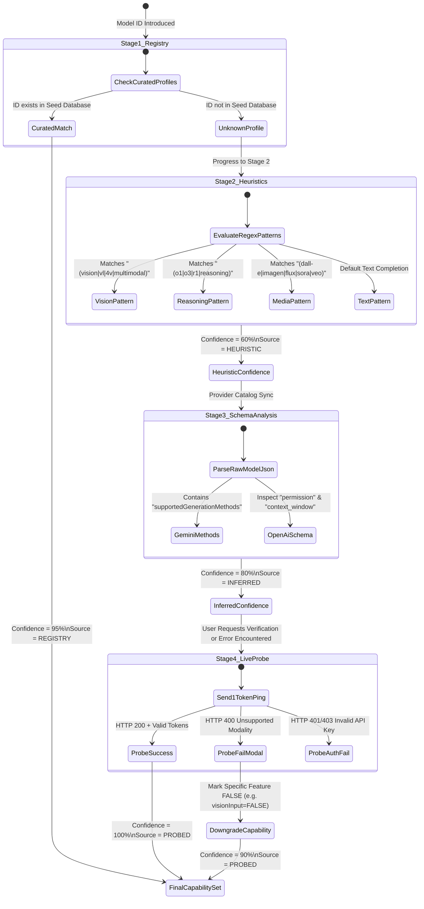
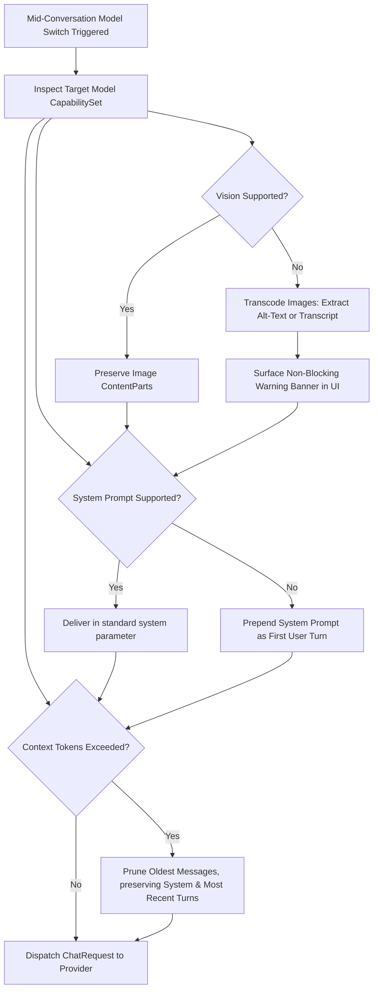

# Capability State Machine & Autonomous Discovery

## 1. Overview & Pipeline Philosophy

AI model naming and feature sets evolve rapidly. Hardcoded lists quickly fall out of date, while blind assumptions cause silent API errors (e.g., sending image payloads to models that only accept text, or expecting reasoning tokens from standard completion endpoints).

OmniChat implements a **4-Stage Capability Discovery Pipeline** governed by a strict state machine.

---

## 2. The 4 Discovery Stages

| Stage | Name | Confidence | Cost / Latency | Mechanism |
|---|---|---|---|---|
| **Stage 1** | Curated Seed Registry | 95% | 0 ms (Local) | Pre-bundled profiles for known industry staples (`gpt-4o`, `claude-3-5-sonnet`, `gemini-1.5-pro`, `o1`, `deepseek-r1`). |
| **Stage 2** | Heuristic Name Parsing | 60% | <1 ms (Regex) | Regular expressions matching token keywords: `.*vision.*`, `.*r1.*`, `.*instruct.*`, `.*embed.*`, `.*dall-e.*`, `.*sora.*`, `.*veo.*`. |
| **Stage 3** | Response / JSON Schema Parsing | 80% | 50–300 ms (Catalog Sync) | Inspects metadata from `/v1/models` (e.g. OpenAI `owned_by`, Gemini `supportedGenerationMethods`, Ollama parameter keys). |
| **Stage 4** | Active 1-Token Live Probe | 100% | 200–800 ms (1 Token API Call) | Sends an ephemeral test payload (1-token completion or tool test) to definitively prove endpoint support. |

---

## 3. Capability State Machine Diagram

---

## 4. Mid-Conversation Model Switching & Modality Degradation

When switching models mid-conversation, conversations frequently contain assets that the new target model cannot natively process. The `ContextTranscoder` performs deterministic transformations:

### Degradation Transformation Rules

1. **Vision Loss (`visionInput: TRUE -> FALSE`)**:
   - High-resolution image payloads are removed from the request array.
   - Replaced by a synthetic system message: `[Image omitted: Model lacks vision capability. Context preserved via previous assistant descriptions.]`
   - Non-blocking banner displayed to user: *"Active model lacks vision. Images in context were transcoded."*

2. **System Prompt Rejection (`systemPromptSupport: FALSE`)**:
   - Model providers that forbid `system` role objects (e.g., legacy Anthropic formats or certain local completion checkpoints) have their system instructions prepended to message 0 as: `[System Instructions: <instructions>]\n\nUser: <first message>`

3. **Tool Call Incompatibility (`functionCalling: FALSE`)**:
   - JSON structured tool definitions are transcoded into system-prompt ReAct-style text instructions: `Answer using the format: Action: <tool_name> Action Input: <json_args>`.
